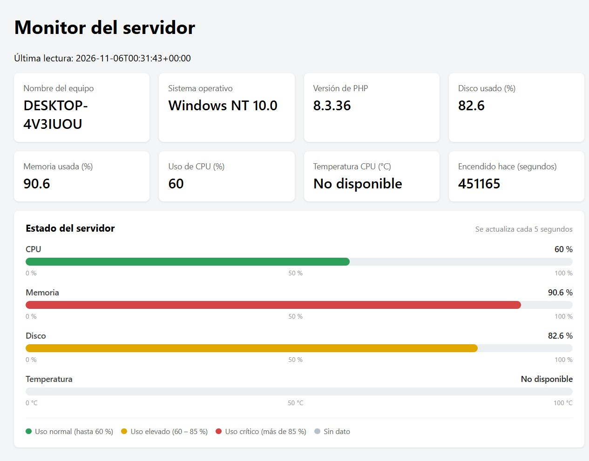
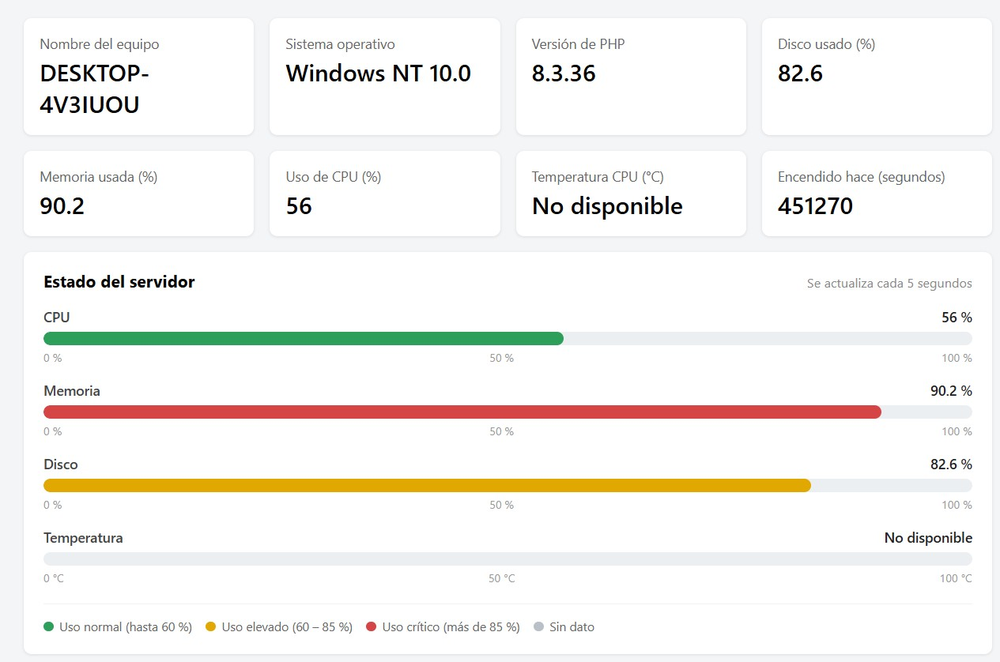
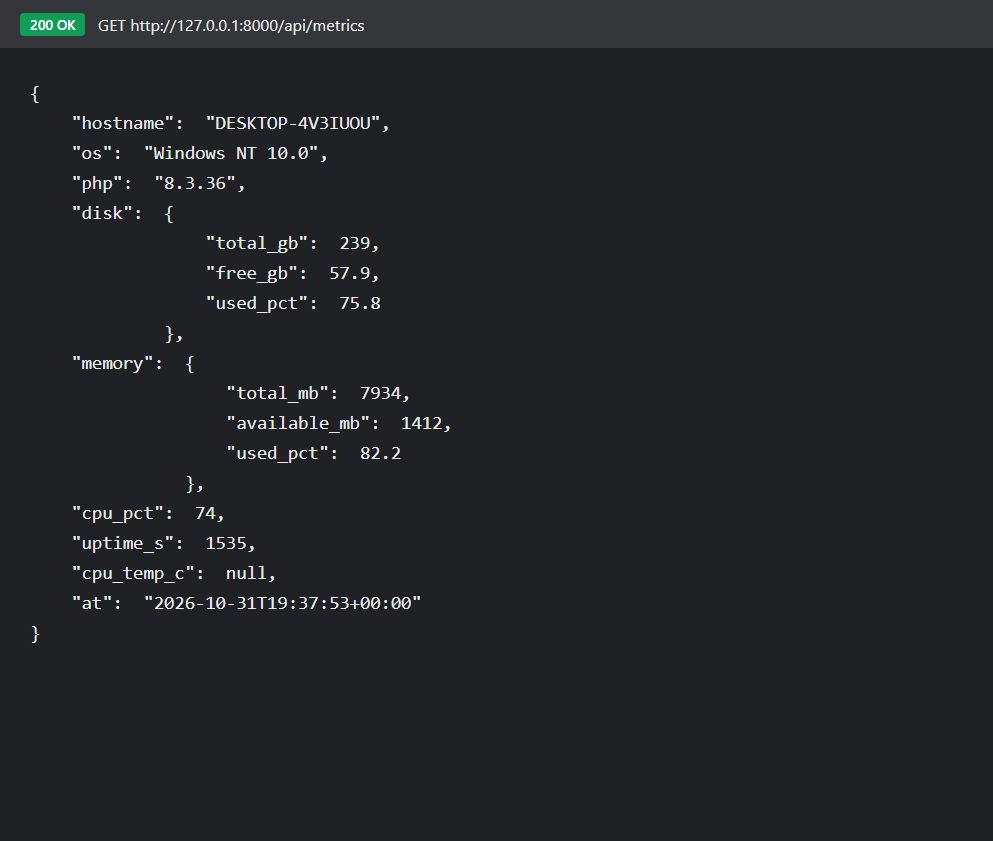
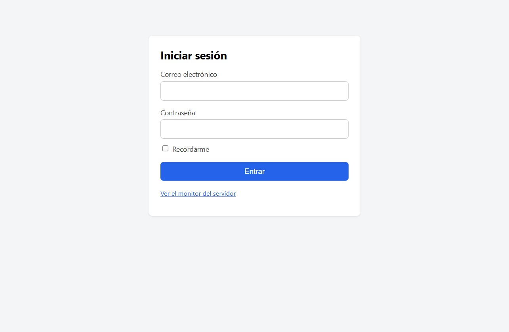
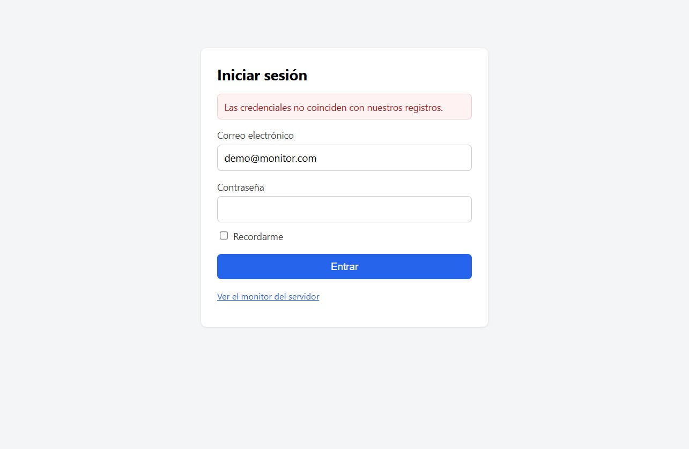
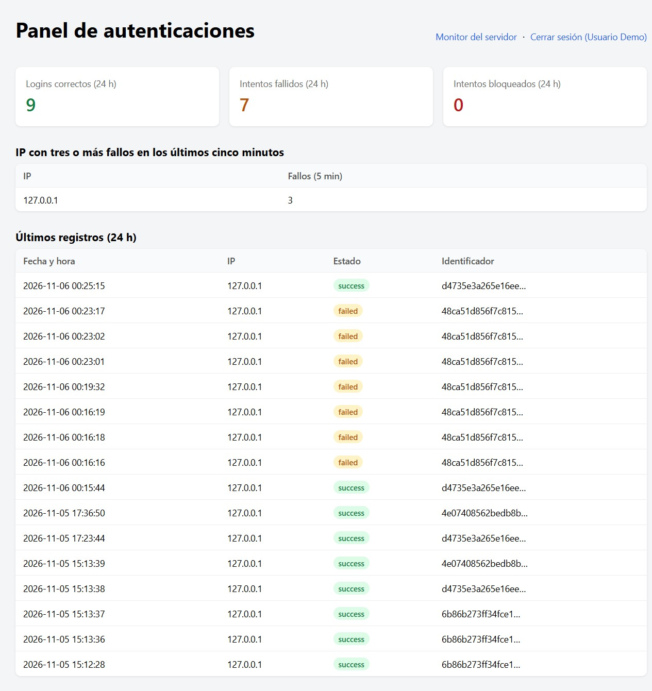

# 🖥️ Monitor de Servidor con Laravel

Trabajo Práctico — **Programación IV** — UTN FRRe — Cohorte 2026

Aplicación Laravel que lee datos del sistema operativo Windows (WMI / PowerShell) y los expone de dos formas:

- **Vista web** en `/servidor` (tarjetas con actualización automática cada 5 segundos).
- **API JSON** en `/api/metrics`.

Ambas salidas consumen el mismo servicio `ServerMetrics`, que concentra toda la lógica de lectura del sistema operativo.

Además incluye un **módulo de seguridad de accesos**: autenticación con registro de cada intento, detección de patrones sospechosos y bloqueo temporal por fuerza bruta, visible en el panel `/panel`.

🔗 **Repositorio:** https://github.com/liabarcos/monitor-servidor

---

## 📋 Entorno utilizado

| Componente | Versión |
|---|---|
| Sistema operativo | **Windows 11 Home Single Language** (10.0.26300) |
| PHP | 8.3.36 |
| Laravel | 13.39.0 |
| Composer | 2.10.3 |
| Servidor de desarrollo | `php artisan serve` |

> El trabajo está pensado para **Windows 10 u 11**, porque usa WMI a través de PowerShell.

---

## 🚀 Instalación y ejecución

### Opción A — Clonar desde GitHub

```powershell
git clone https://github.com/liabarcos/monitor-servidor.git
cd monitor-servidor
composer install
Copy-Item .env.example .env
php artisan key:generate
New-Item database/database.sqlite
php artisan migrate
php artisan serve
```

### Opción B — Desde el ZIP de respaldo

Descomprimir `monitor-servidor-backup-*.zip` (incluye `vendor` y `.env`) y ejecutar:

```powershell
cd monitor-servidor
php artisan serve
```

Luego abrir:

- Vista web: <http://127.0.0.1:8000/servidor>
- API JSON: <http://127.0.0.1:8000/api/metrics>

> **Requisito:** PHP 8.3 o superior. Si `shell_exec()` está deshabilitado, quitarlo de `disable_functions` en el `php.ini`.

---

## 🏗️ Arquitectura

| Parte | Archivo | Responsabilidad |
|---|---|---|
| **Service** | `app/Services/ServerMetrics.php` | *Cómo* se obtienen los datos. Única clase que habla con el SO. |
| **Controlador** | `app/Http/Controllers/ServerController.php` | *Qué* se responde y en *qué formato*: vista o JSON. |
| **Vista** | `resources/views/servidor.blade.php` | *Cómo* se muestran los datos: tarjetas, barras de uso y polling. |
| **Rutas** | `routes/web.php`, `routes/api.php` | `/servidor` y `/api/metrics`. |

El controlador recibe el service por **inyección de dependencias**: al declarar `index(ServerMetrics $metrics)`, Laravel lo crea y lo pasa automáticamente (service container). No se usa `new`.

### ¿Cómo se leen los datos?

| Dato | Fuente |
|---|---|
| Nombre del equipo | `gethostname()` (PHP) |
| Sistema operativo | `php_uname()` (PHP) |
| Versión de PHP | `PHP_VERSION` |
| Disco | `disk_total_space()` / `disk_free_space()` |
| Memoria | WMI `Win32_OperatingSystem` |
| Uso de CPU | WMI `Win32_Processor` (`LoadPercentage`) |
| Tiempo encendido | WMI `LastBootUpTime` |
| Temperatura CPU | WMI `MSAcpi_ThermalZoneTemperature` |

`readWindows()` arma un script de PowerShell fijo, lo codifica en **Base64 UTF-16LE** y lo ejecuta con `powershell -EncodedCommand`. La salida se pide con `ConvertTo-Json -Compress` y se decodifica con `json_decode()`. Si un dato no se puede leer, queda en `null` y la vista muestra **"No disponible"** sin romperse.

---

## 🔌 API JSON

```http
GET /api/metrics
```

- Límite: `throttle:60,1` → máximo **60 pedidos por minuto por IP**.
- Respuesta real de este equipo:

```json
{
    "hostname": "DESKTOP-4V3IUOU",
    "os": "Windows NT 10.0",
    "php": "8.3.36",
    "disk": {
        "total_gb": 239,
        "free_gb": 57.9,
        "used_pct": 75.8
    },
    "memory": {
        "total_mb": 7934,
        "available_mb": 1412,
        "used_pct": 82.2
    },
    "cpu_pct": 74,
    "uptime_s": 1535,
    "cpu_temp_c": null,
    "at": "2026-10-31T19:37:53+00:00"
}
```

Prueba desde PowerShell:

```powershell
Invoke-RestMethod http://127.0.0.1:8000/api/metrics
```

---

## 📸 Capturas

Todas las capturas se tomaron contra el servidor corriendo en `http://127.0.0.1:8000`.

### Vista web `/servidor`



### Estado del servidor — barras de uso

Debajo de las tarjetas, cada métrica se representa con una barra que se colorea según el tramo de uso:



| Barra | Origen | Rango |
|---|---|---|
| CPU | WMI `Win32_Processor` (`LoadPercentage`) | 0 – 100 % |
| Memoria | WMI `Win32_OperatingSystem` | 0 – 100 % |
| Disco | `disk_total_space()` / `disk_free_space()` | 0 – 100 % |
| Temperatura | WMI `MSAcpi_ThermalZoneTemperature` | 0 – 100 °C |

Colores según el valor: **verde** hasta 60 %, **ámbar** de 60 a 85 %, **rojo** por encima de 85 % y **gris** cuando no hay dato. La temperatura aparece en gris porque requiere iniciar el servidor como administrador (ver pregunta 1).

Las barras se actualizan en el mismo `setInterval` de 5 segundos que usa el resto de la vista.

### Respuesta de `/api/metrics`



### Acceso al panel `/panel`

El panel está protegido: sin sesión redirige al login.



### Intento de acceso fallido

La app rechaza la contraseña y deja constancia del evento:



### Panel de monitoreo — intentos exitosos y fallidos

Contadores de las últimas 24 horas, IP con actividad sospechosa y el listado de eventos con el resultado de cada intento:



En la captura se puede ver:

- **9 logins correctos** y **7 intentos fallidos** en las últimas 24 horas.
- La IP `127.0.0.1` marcada por acumular **3 fallos en 5 minutos**.
- Los eventos `success` (verde) y `failed` (amarillo) en el mismo listado.

---

## 🔄 Actualización automática (polling)

La vista no se recarga: un `setInterval` llama a `/api/metrics` cada **5 segundos** y actualiza solo los valores del DOM.

Verificado en la pestaña **Red (F12)**: dos pedidos a `/api/metrics` separados por 5002 ms, ambos HTTP 200, sin errores de consola.

Con 5 s de intervalo, cada cliente genera **12 pedidos por minuto**.

---

## 🔐 Seguridad de accesos

Módulo agregado al monitor: cada intento de autenticación queda registrado y el panel lo muestra en vivo.

### Cómo funciona

| Parte | Archivo | Responsabilidad |
|---|---|---|
| **Login** | `app/Http/Controllers/AuthController.php` | Muestra el formulario, valida credenciales y cierra sesión. |
| **Panel** | `app/Http/Controllers/MonitoringController.php` | Consulta contadores, IP sospechosas y eventos de las últimas 24 h. |
| **Registro** | `app/Listeners/RecordSecurityAuthentication.php` | Escucha los eventos `Login` y `Failed` y escribe en la tabla y en el log. |
| **Guardia** | `app/Http/Middleware/SecurityLoginGuard.php` | Cuenta fallos por IP y bloquea antes de procesar el intento. |
| **Modelo** | `app/Models/LoginAttempt.php` | Tabla `login_attempts`. |

### Registro de eventos

Al autenticarse se disparan los eventos `Illuminate\Auth\Events\Login` y `Failed`, que el listener `AppServiceProvider` deja suscritos. Cada evento escribe:

- una fila en `login_attempts` con el **hash SHA-256** del identificador (nunca el correo en claro), la IP, el estado y el navegador;
- una línea en el canal de log `security` (`storage/logs/security-*.log`) con nivel `info` si fue correcto y `warning` si falló.

### Bloqueo por fuerza bruta

La middleware `SecurityLoginGuard` se ejecuta **antes** de procesar el intento:

| Fallos en 5 min (misma IP) | Acción |
|---|---|
| 1 – 2 | Se procesa el intento normalmente. |
| 3 – 4 | Se registra un `alert` en el log de seguridad (patrón sospechoso). |
| 5 o más | Se bloquea la IP durante **10 minutos** y responde **HTTP 429**. |

Los intentos bloqueados también se guardan con estado `blocked`, por eso el panel muestra la tercera tarjeta "Rechazos por bloqueo".

### Rutas

| Método | Ruta | Descripción |
|---|---|---|
| GET | `/login` | Formulario de acceso. |
| POST | `/login` | Intento de autenticación (con la guardia anti fuerza bruta). |
| POST | `/logout` | Cierra la sesión. |
| GET | `/panel` | Panel de monitoreo. Requiere sesión (`auth`). |

### Verificación

```powershell
php artisan test
```

```text
PASS  Tests\Feature\SecurityLoggingTest
  ✓ login valido registra info y success
  ✓ dos passwords incorrectas registran dos warning
  ✓ tres fallos generan alert en el siguiente intento
  ✓ cinco fallos bloquean la ip durante diez minutos
  ✓ ip bloqueada responde 429 y registra blocked
  ✓ panel requiere autenticacion

Tests: 8 passed (25 assertions)
```

---

## ❓ Preguntas del TP

### 1. ¿Por qué la temperatura suele aparecer como "No disponible" en Windows?

Porque el dato depende de dos condiciones que casi nunca se cumplen juntas:

1. **Permisos:** `MSAcpi_ThermalZoneTemperature` vive en el namespace WMI `root/wmi` y su lectura requiere **privilegios de administrador**. En este equipo, consultarlo desde una consola normal devuelve literalmente:

   ```text
   Get-CimInstance : Acceso denegado
   ```

   El `try/catch` del script captura ese error y deja `temp_c = null`, por eso la vista muestra "No disponible".

2. **Soporte del hardware/firmware:** aunque se ejecute como administrador, muchas placas madre y notebooks no exponen la zona térmica ACPI por WMI (o la informan con otra escala). En ese caso la consulta no devuelve ningún objeto y el valor sigue siendo `null`.

**Comparación pedida (probada en este equipo):**

- **Terminal sin privilegios** (`IsInRole(Administrator)` → `False`):

  ```text
  PS> Get-CimInstance -Namespace root/wmi -ClassName MSAcpi_ThermalZoneTemperature
  Get-CimInstance : Acceso denegado
  ```

- **Terminal como administrador** (`IsInRole(Administrator)` → `True`): la consulta responde correctamente.

  ```text
  InstanceName       : ACPI\ThermalZone\TZ00_0
  CurrentTemperature : 3010
  ```

  El valor viene en décimas de Kelvin: `3010 / 10 − 273.15 ≈ 27,9 °C`.

**Conclusión:** en este equipo la placa **sí** informa la temperatura; lo que faltaba era ejecutar con privilegios de administrador. Como `php artisan serve` se lanza normalmente sin elevación, el proceso de PowerShell que abre PHP hereda ese token sin permisos y el dato queda en `null` (la vista muestra "No disponible"). Para verlo en la vista habría que iniciar el servidor desde una terminal elevada. En equipos donde la placa no exponga la zona térmica ACPI, el valor seguirá siendo `null` incluso como administrador: el service asume ese caso y un dato faltante nunca rompe la app.

### 2. ¿Por qué el script de PowerShell nunca debe incluir datos que vengan del usuario?

Porque `shell_exec()` ejecuta una **cadena de comando** en el sistema. Si esa cadena se arma concatenando datos del usuario (formularios, parámetros de URL, cabeceras), un atacante puede inyectar comandos arbitrarios y ejecutarlos con los permisos del servidor web. Por ejemplo, si se hiciera:

```php
shell_exec("powershell -Command Get-Process $nombreUsuario");
```

y el usuario envía `; Remove-Item C:\ -Recurse`, el servidor ejecutaría ambas cosas. Es una vulnerabilidad de **inyección de comandos (RCE)**.

Por eso el script es **fijo** y va codificado en Base64: no se interpola ningún dato externo. Si algún día hiciera falta parametrizar, habría que validar contra una lista blanca y usar APIs que no pasen por la shell.

### 3. ¿Qué riesgo tiene dejar `/api/metrics` sin autenticación en un servidor real?

- **Fuga de información (information disclosure):** expone nombre del equipo, versión de Windows, versión exacta de PHP, memoria, CPU y uptime. Es información ideal para *fingerprinting*: permite buscar vulnerabilidades conocidas de esa versión de PHP/SO y planear un ataque.
- **Agotamiento de recursos (DoS):** cada pedido lanza un proceso de PowerShell que tarda ~4–5 s de CPU. Un atacante puede saturar el servidor con pocas peticiones concurrentes. El `throttle:60,1` ayuda, pero no reemplaza la autenticación.
- **Exposición de la infraestructura interna:** revela que hay un servidor Windows y su estado, datos que no deberían ser públicos.

**Mitigación:** proteger la ruta con `->middleware('auth:sanctum')`, usar HTTPS, limitar por IP/firewall y, si es posible, cachear la lectura para no ejecutar PowerShell en cada request.

### 4. Con polling cada 5 segundos, ¿cuántos pedidos por minuto recibe el servidor si hay 50 personas mirando?

Cada persona hace un pedido cada 5 s → `60 / 5 = 12` pedidos por minuto.

```text
12 pedidos/min × 50 personas = 600 pedidos/minuto
```

Es decir, **10 pedidos por segundo**, y cada uno abre un proceso de PowerShell. La mayoría de esos pedidos devuelven datos que no cambiaron: es el desperdicio que resuelven los WebSockets (el servidor avisa solo cuando hay novedades).

### 5. Si una app solo necesita la temperatura, ¿qué datos recibe de más al llamar a `/api/metrics`?

Recibe **todo** el snapshot aunque solo use `cpu_temp_c`:

- `hostname`, `os`, `php` (identificación del servidor),
- `disk` completo (`total_gb`, `free_gb`, `used_pct`),
- `memory` completo (`total_mb`, `available_mb`, `used_pct`),
- `cpu_pct`, `uptime_s` y `at`.

Ese exceso se llama **over-fetching**. Con GraphQL la app pediría únicamente:

```graphql
query {
  metrics {
    cpu_temp_c
  }
}
```

y el servidor devolvería solo ese campo.

---

## 🔒 Seguridad

- El script de PowerShell es **fijo**: nunca se construye con datos del usuario (evita inyección de comandos).
- El endpoint tiene **rate limiting** (`throttle:60,1`).
- **Autenticación** en `/panel`: sin sesión redirige a `/login`.
- **Anti fuerza bruta:** 5 fallos en 5 minutos por IP → bloqueo de 10 minutos con respuesta HTTP 429.
- **Sin datos personales en claro:** los intentos guardan un hash SHA-256 del identificador, nunca el correo.
- **Log de seguridad aparte** (`storage/logs/security-*.log`), con retención de 30 días, separado del log general.
- `.env`, `vendor` y la base SQLite **no se versionan** (están en `.gitignore`), así que las credenciales no se filtran al repositorio.
- En producción correspondería HTTPS, y el endpoint del monitor podría protegerse con `auth:sanctum`.

---

## 📁 Estructura relevante

```text
app/
├── Http/Controllers/
│   ├── ServerController.php          # vista + API del monitor
│   ├── AuthController.php            # login / logout
│   └── MonitoringController.php      # panel de autenticaciones
├── Http/Middleware/
│   └── SecurityLoginGuard.php        # bloqueo por fuerza bruta
├── Listeners/
│   └── RecordSecurityAuthentication.php  # registra login/failed
├── Models/
│   └── LoginAttempt.php              # tabla login_attempts
└── Services/
    └── ServerMetrics.php             # lectura del sistema operativo
resources/views/
├── servidor.blade.php                # tarjetas + polling
├── auth/login.blade.php              # formulario de acceso
└── panel.blade.php                   # panel de monitoreo
routes/
├── web.php                           # /, /servidor, /login, /panel
└── api.php                           # /api/metrics
database/migrations/
└── ..._create_login_attempts_table.php
docs/capturas/                        # capturas para la entrega
```

---

## 👤 Autor

**liabarcos** — [github.com/liabarcos](https://github.com/liabarcos)
